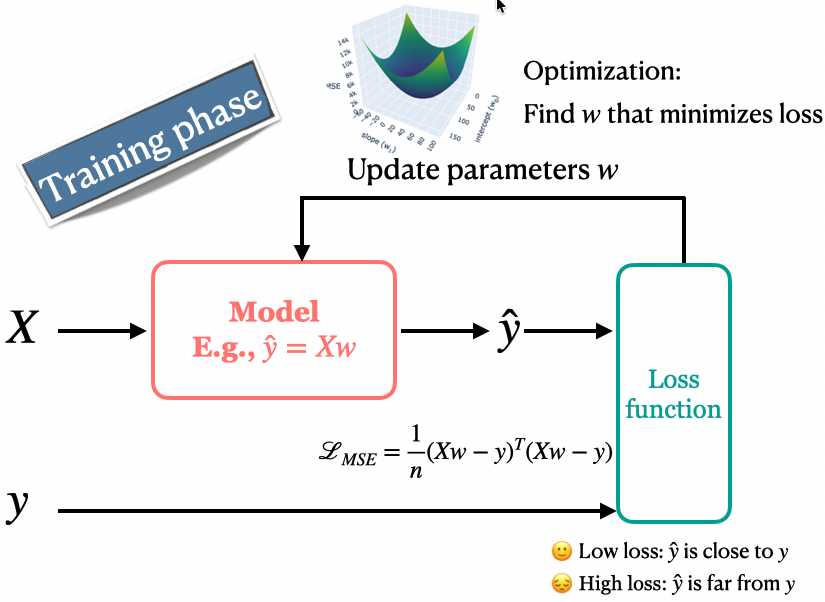

```{python}
#| include: false
from pathlib import Path

import matplotlib.pyplot as plt
import numpy as np
import pandas as pd
from IPython.display import HTML, Markdown, display
from sklearn.dummy import DummyRegressor
from sklearn.linear_model import LinearRegression, LogisticRegression, Ridge
from sklearn.model_selection import cross_validate, train_test_split
from sklearn.pipeline import make_pipeline
from sklearn.preprocessing import StandardScaler

DATA_DIR = Path("data")
```

## Focus on the breath!

{.nostretch fig-align="center" width="500px"}

::: {.notes}
Before we begin, take a moment to settle in. Put your feet on the floor, relax your shoulders, and take a slow breath in and out. [Pause.] Let's bring our attention to today's class.
:::

## Announcements

## iClicker: Hyperparameter search recap {.slide-your-turn .smaller}

```python
search = RandomizedSearchCV(
    make_pipeline(StandardScaler(), SVC()),
    {"svc__C": loguniform(1e-2, 1e2),
     "svc__gamma": loguniform(1e-3, 1e1)},
    n_iter=20, cv=5, random_state=123,
)
search.fit(X_train, y_train)
```

Select all statements that are **true**.

- **A.** The search samples 20 candidate combinations, each evaluated using five-fold CV.
- **B.** For `C`, the intervals 0.01–0.1, 0.1–1, 1–10, and 10–100 are equally likely.
- **C.** By default, the selected pipeline is refitted on all of `X_train`.
- **D.** Increasing `n_iter` guarantees better performance on new data.

::: {.notes}
Opening recap: allow about one minute to vote, then discuss within the four-minute opening allocation. Correct answers: A, B, and C. RandomizedSearchCV samples 20 candidate C/gamma combinations and evaluates each with five-fold CV. Log-uniform sampling gives equal probability to equal-width intervals on the logarithmic scale: each of the four tenfold C intervals has probability one quarter. It does not give equal probability to equal-width intervals on the original scale. With default refit=True, the selected pipeline is fitted again on all supplied training data. Each fold fits its scaler using only that fold's training portion. More candidates can improve the best observed CV score without improving generalization; model selection can overfit validation results. The code assumes the familiar imports from sklearn.model_selection, sklearn.pipeline, sklearn.preprocessing, sklearn.svm, and scipy.stats.loguniform. If votes are split, invite a short neighbour discussion and revote. Transition: search chooses hyperparameter settings, while each candidate's fit learns a prediction rule. Today we examine the coefficients that linear models learn during fitting.
:::

## Today’s roadmap {.slide-goals}

1. **Notation:** represent examples, features, and targets.
2. **Linear regression and MSE:** predict, then measure error.
3. **Ridge:** control complexity with `alpha`.
4. **Logistic regression and log loss:** predict and fit probabilities.
5. **Parametric versus non-parametric:** compare what models retain.

::: {.notes}
Opening and recap: 4 minutes total. The recurring questions are what the model calculates, what fitting minimizes, and what controls complexity. Instructor pacing: notation 10 minutes; regression 18; Ridge 13; break 5; logistic regression 22; model families 6; closing 2. Total 80 minutes. If discussion runs long, shorten the opening recap or omit backup questions; preserve the dataset-level loss calculations and core prediction activities.
:::

# Notation

How do we represent data and predictions?

::: {.notes}
10 minutes including matching, transpose practice, and discussion. Start with retrieval before explaining the notation.
:::

## Your turn: Match the notation {.slide-your-turn}

Match each symbol to a meaning.

| Symbol | Meaning (shuffled) |
|---|---|
| $X$ | A. Number of represented features |
| $\mathbf y$ | B. Feature matrix |
| $\mathbf x_i$ | C. Predicted targets |
| $\hat{\mathbf y}$ | D. Features of example $i$ |
| $n$ | E. Observed targets |
| $d$ | F. Number of examples |

::: {.notes}
Allow one minute individually, then thirty seconds to compare with a neighbour. The two columns are independent lists: match symbols to letters rather than reading across each row. Answers: X → B, y → E, x_i → D, y hat → C, n → F, d → A. Ask which symbols were unfamiliar before advancing. Use the next slide to reveal the matches, then connect them to the student data on the following slide. Coefficients and transpose are introduced after this retrieval exercise.
:::

## Notation: Answers {.smaller}

| Symbol | Match | Meaning |
|---|:---:|---|
| $X$ | B | Feature matrix |
| $\mathbf y$ | E | Observed targets |
| $\mathbf x_i$ | D | Features of example $i$ |
| $\hat{\mathbf y}$ | C | Predicted targets |
| $n$ | F | Number of examples |
| $d$ | A | Number of represented features |

::: {.notes}
Reveal after the matching discussion. Ask students to check their answers and clarify any unfamiliar symbols. Emphasize observed versus predicted targets and examples versus features. Keep the reveal brief within the ten-minute notation allocation. The next slide connects these symbols to the student table.
:::

## From a data table to a matrix {.smaller}

| Student | Hours studied | Practice sets | Observed grade |
|---|---:|---:|---:|
| A | 5 | 6 | 75 |
| B | 2 | 3 | 62 |
| C | 7 | 5 | 86 |

$$X=\begin{bmatrix}5&6\\2&3\\7&5\end{bmatrix},
\qquad \mathbf y=\begin{bmatrix}75\\62\\86\end{bmatrix}$$

- $X$: $n$ examples as **rows**, $d$ represented features as **columns**.
- Here $n=3$, $d=2$; observed targets are separate from $X$.
- $\mathbf x_1=[5,6]^{\mathsf T}$ contains student A's features; $\hat{\mathbf y}$ will contain predicted grades.
- The model receives numerical features produced by our preprocessing.

::: {.notes}
Ask which entry represents student B's practice sets: row two, column two, value three. Feature names help us understand the table, but the model calculates with the supplied representation. One-hot encoding and bag-of-words determine what information appears in these columns. The grade is not a feature.
:::

## Your turn: Transpose and shape {.slide-your-turn .smaller}

$$X=\begin{bmatrix}5&6\\2&3\\7&5\end{bmatrix},
\qquad \mathbf x_1=\begin{bmatrix}5\\6\end{bmatrix}$$

1. What are the shapes of $X$ and $\mathbf x_1$? Use **rows × columns**.
2. Write $X^{\mathsf T}$ and $\mathbf x_1^{\mathsf T}$.
3. Where does student A appear in $X^{\mathsf T}$?

::: {.notes}
Give pairs two minutes. If transpose is unfamiliar, invite a guess and explain that the superscript T asks us to exchange rows and columns. X has shape 3 by 2 and x_1 has shape 2 by 1. X transpose has rows [5,2,7] and [6,3,5], so its shape is 2 by 3. x_1 transpose is [5,6], of shape 1 by 2. Student A becomes the first column of X transpose. Reveal the explanation on the next slide after discussion.
:::

## Transpose exchanges rows and columns {.smaller}

$$X=\begin{bmatrix}5&6\\2&3\\7&5\end{bmatrix}
\quad\longrightarrow\quad
X^{\mathsf T}=\begin{bmatrix}5&2&7\\6&3&5\end{bmatrix}$$

$$\underbrace{\mathbf x_1=\begin{bmatrix}5\\6\end{bmatrix}}_{2\times1}
\qquad
\underbrace{\mathbf x_1^{\mathsf T}=\begin{bmatrix}5&6\end{bmatrix}}_{1\times2}$$

- $X$: $3\times2$; $X^{\mathsf T}$: $2\times3$.
- Student A is row 1 of $X$ and column 1 of $X^{\mathsf T}$.
- In general, transposing an $n\times d$ matrix gives a $d\times n$ matrix.

::: {.notes}
Connect each answer to the preceding exercise. The values do not change, but their row and column positions exchange. A transpose is not a reversal of the entries. We write an individual feature vector as a column; its transpose appears as a row in X. Ask students what happens if we transpose twice: we recover the original matrix. Mathematical shape conventions differ from one-dimensional NumPy arrays; scikit-learn commonly accepts targets of shape (n,), so students should not reshape working arrays solely to match the notation.
:::

# Linear regression and MSE

How do we make predictions and choose a useful model?

::: {.notes}
18 minutes including the connected loss activity. Reuse the student-grade data; prediction first, then a criterion for choosing coefficients.
:::

## Learning a prediction function {.smaller}

In supervised learning, we use training examples to learn a function that maps features to a prediction:

$$\mathbf x\ \longrightarrow\ \hat f(\mathbf x)\ \longrightarrow\ \hat y$$

So far, our models have represented this function using:

- **Decision trees:** a sequence of splits.
- **$k$-NN:** targets of nearby training examples.
- **RBF SVMs:** flexible decision boundaries.

**Linear regression restricts the prediction function to a weighted sum of the represented features plus an intercept.**

::: {.notes}
Keep this introduction to about one minute within the existing 18-minute regression allocation. Training pairs X and y provide examples from which we learn a prediction function; for a new example x, that function produces y hat. Previous model families also impose assumptions, so avoid suggesting they were assumption-free. Here we explicitly restrict the form of the prediction function. This is a modelling choice, not a claim that the true relationship must be linear or every target must lie on a line. Say linear in the represented features, since preprocessing determines those inputs. The next slide makes the restriction concrete with one feature and a straight line. Later, logistic regression keeps the weighted score but applies a sigmoid to obtain a probability.
:::

## Linear regression: One feature {.model-plot .smaller}

:::: {.columns}

::: {.column width="45%"}
- Linear regression models a numeric target using a weighted sum of the features and an intercept.
- In this case, with only one feature, our model is a straight line.
- What do we need to represent a line?
  - Slope ($w_1$): Determines the angle of the line.
  - Y-intercept ($b$): Where the line crosses the y-axis.

:::

::: {.column width="55%"}
```{python}
import matplotlib.pyplot as plt
import numpy as np
# Data
hours_studied = [0.5, 1.0, 2.0, 2.0, 3.5, 4.0, 5.5, 6.0]
grades = [25, 35, 70, 40, 60, 55, 75, 80]

# Convert data to numpy arrays and reshape for model fitting
X = np.array(hours_studied).reshape(-1, 1)
y = np.array(grades)

from sklearn.linear_model import LinearRegression
# Fit a linear regression model
model = LinearRegression()
model.fit(X, y)

# Generate predictions for plotting the regression line
X_range = np.linspace(X.min(), X.max(), 100).reshape(-1, 1)
y_pred = model.predict(X_range)

# Plotting the data points and the regression line
plt.figure(figsize=(8, 4))
plt.scatter(X, y, color='green', edgecolors='black', s=130, label='Data Points')
plt.plot(X_range, y_pred, color='blue', linewidth=2, label='Regression Line')
plt.xlabel('# hours studied')
plt.ylabel('% grade in Quiz 2')
plt.title('Linear Models: Prediction')
plt.legend()
plt.grid(True)
plt.show()
```
- Making predictions: $\hat{y} = w_1 \times \text{\# hours studied} + b$

:::
::::

::: {.notes}
Let's start with a numeric target: a quiz grade. Each point shows hours studied and an observed grade. A linear model predicts a grade using a straight line. The slope tells us how much the predicted grade changes for an additional hour; the intercept is the prediction at zero hours. The line does not need to pass through every point. We need a way to choose a useful line, and that will lead us to loss.
:::

## Predictions with multiple features {.smaller}

| Feature | Value | Coefficient | Contribution |
|---|---:|---:|---:|
| Hours studied ($x_1$) | 5 | 4 | 20 |
| Practice sets ($x_2$) | 6 | 2 | 12 |
| Intercept ($b$) | | | 45 |

The predicted grade is $20+12+45=77$.

$$\hat{y}=w_1x_1+\cdots+w_dx_d+b=\mathbf{w}^{\mathsf T}\mathbf{x}+b$$

- The dot product means **multiply corresponding entries and add**.
- We learn one coefficient per feature and an intercept, shared across examples.

::: {.notes}
A coefficient describes the change in the model’s prediction per feature unit, holding other represented features fixed. Interpret this with care: it does not establish causation. Lecture 8 develops interpretation.
:::

::: {.notes}
With multiple features, the prediction is still a weighted sum. Five hours contributes twenty points, six practice sets contributes twelve, and the intercept adds forty-five. Together, the prediction is seventy-seven. The dot product is just shorthand for multiplying corresponding feature values and coefficients and adding the results. The model learns one shared coefficient per feature, rather than a separate coefficient for each student.
:::

## Your turn: What shape is a prediction? {.slide-your-turn .smaller}

For three students and two features:

$$\underbrace{X}_{3\times2}\quad
\underbrace{\mathbf w=\begin{bmatrix}4\\2\end{bmatrix}}_{2\times1}
\quad b=45$$

1. What is the shape of $X\mathbf w$?
2. What is the shape of $\mathbf w^{\mathsf T}\mathbf x_1$, the weighted sum for one student?
3. Do $\mathbf w^{\mathsf T}\mathbf x_1$ and $\mathbf x_1^{\mathsf T}\mathbf w$ give the same value? Use $\mathbf x_1=[5,6]^{\mathsf T}$.

::: {.fragment}
$(3\times2)(2\times1)\rightarrow3\times1$: **one value per student**.

$(1\times2)(2\times1)\rightarrow1\times1$: **one weighted sum**. Both dot-product orders give $32$.
:::

::: {.notes}
Allow about ninety seconds before revealing the answers. Both products have shape (1 by d)(d by 1) and produce the same scalar for real vectors: 4×5 + 2×6 = 5×4 + 6×2 = 32. Adding the intercept gives 77. This equality does not mean matrix multiplication can generally be reversed. The inner dimensions must match; the outer dimensions give the result's shape. For Xw, every row supplies two values to multiply by the same two weights, producing one result per student. For w transpose x_1, the dot product is a scalar, represented here as a 1 by 1 result. Adding b to every entry does not change the shape. The coefficients have shape d by 1 and the intercept is scalar. Ask students to explain the output in words before applying the dimension rule. The next slide computes all three predictions.
:::

## One rule for every example {.smaller}

$$\hat{\mathbf y}=X\mathbf w+b
=\begin{bmatrix}5&6\\2&3\\7&5\end{bmatrix}
\begin{bmatrix}4\\2\end{bmatrix}+45
=\begin{bmatrix}77\\59\\83\end{bmatrix}$$

- Each row uses the **same** coefficients and intercept.
- $+b$ means adding the intercept to every prediction.
- One feature gives a line; two give a plane; more give a hyperplane.

A coefficient describes a prediction change with other features fixed; interpret it carefully, **not as a causal effect**.

::: {.notes}
Give students a moment to calculate the second or third prediction. Briefly mention the coefficient-interpretation caution; details are reserved for lecture 8. For B, two times four plus three times two plus forty-five is fifty-nine. Adding a student adds a row of X and an entry to the prediction vector; it does not add a coefficient. Refitting could change the coefficient values. The intercept addition is shorthand for adding b times a vector of n ones. We will return to the parameter-count question later.
:::

## What happens during `fit` {.smaller}

:::: {.columns}

::: {.column width="60%"}

{.nostretch fig-align="center" width="100%"}
:::

::: {.column width="40%"}
For a linear model, `fit` learns the **coefficients and intercept**:

1. **Predict:** use candidate parameters to compute $\hat{y}$ from the training features.
2. **Measure error:** compare $\hat{y}$ with the observed targets $y$ using a **loss function**.
3. **Optimize:** choose coefficients and an intercept that minimize training loss.

:::
::::

::: {.notes}
We know how to make a prediction once we have the weights and intercept. The next question is: how does fit choose those values? For a linear model, these are the parameters we learn from the training data.

Follow the diagram from left to right. With candidate parameter values, the model turns training features into predictions. The loss function compares those predictions with the observed targets and measures their disagreement. Lower loss means better agreement according to that particular loss function. Different losses can favor different predictions.

Optimization chooses coefficients and an intercept that minimize training loss. For linear regression without a penalty, we use squared-error loss.

The loop illustrates an iterative optimizer: predict, measure error, update parameters, and repeat. Some linear models can instead be fitted using direct numerical methods, so not every fit literally follows this loop. Other model families learn differently: k-NN mainly stores training examples, while a decision tree chooses splits. Here we are focusing on how linear models learn their parameters.

During training, observed targets provide the feedback. At prediction time, a new example only follows the features-to-prediction path; we do not need its target. Next, let's make the loss concrete by looking at residuals and squared error.
:::

## Residuals and squared-error loss {.smaller}

A **residual** is the observed target minus the prediction: $y-\hat{y}$.

| Observed grade $y$ | Prediction $\hat{y}$ | Residual | Squared error |
|---:|---:|---:|---:|
| 70 | 68 | 2 | 4 |
| 70 | 66 | 4 | 16 |

$$\mathrm{MSE}=\frac{1}{n}\sum_{i=1}^{n}(y_i-\hat{y}_i)^2=\frac{4+16}{2}=10$$

- Positive residual: prediction too low. Negative residual: prediction too high.
- Optimization chooses coefficients and an intercept to minimize squared-error loss.
- Squared error penalizes large prediction errors more heavily than small ones.

::: {.notes}
A residual is observed minus predicted. Predicting sixty-eight when the grade is seventy gives a residual of two. Predicting sixty-six gives a residual of four. Squaring gives four and sixteen, so the larger mistake contributes disproportionately more. Averaging these squared errors gives an MSE of ten. Squaring also prevents positive and negative residuals from cancelling. Optimization chooses coefficients and an intercept to minimize squared error.
:::

## MSE across all three students {.smaller}

Reuse the predictions from $\hat{\mathbf y}=X\mathbf w+b$:

$$\mathbf y=\begin{bmatrix}75\\62\\86\end{bmatrix},\quad
\hat{\mathbf y}=\begin{bmatrix}77\\59\\83\end{bmatrix},\quad
\mathbf r=\mathbf y-\hat{\mathbf y}=\begin{bmatrix}-2\\3\\3\end{bmatrix}$$

$$\mathrm{MSE}=\frac{(-2)^2+3^2+3^2}{3}=\frac{22}{3}\approx7.33$$

Each example contributes a squared error; the **mean** combines all examples into one loss.

::: {.notes}
Walk from observed targets and predictions to the residual vector. Ask which prediction is too high: the first, because its residual is negative. The squared errors are 4, 9, and 9. Sum all three before dividing by n=3. These are the same students and hypothetical parameters used earlier. This example explains the calculation, not an independent evaluation of a fitted model. No norm notation is needed.
:::

## Your turn: Compare two candidates {.slide-your-turn}

$$X=\begin{bmatrix}5&6\\2&3\\7&5\end{bmatrix},\qquad
\mathbf y=\begin{bmatrix}75\\62\\86\end{bmatrix}$$

| Candidate | $\mathbf w$ | $b$ | $\hat{\mathbf y}=X\mathbf w+b$ | MSE |
|---|---|---:|---|---:|
| A | $[4,2]^{\mathsf T}$ | 45 | $[77,59,83]^{\mathsf T}$ | 7.33 |
| B | $[3,3]^{\mathsf T}$ | 45 | $[78,60,81]^{\mathsf T}$ | ? |

Verify B’s predictions and calculate its MSE. Which candidate results in a lower MSE?

::: {.fragment}
B: $(9+4+25)/3\approx12.67$. **A has lower MSE.**
:::

::: {.notes}
Allow two minutes. Reuse the same three students and two features as the preceding worked example. X has shape 3 by 2; each coefficient vector has shape 2 by 1; b is scalar. For B, multiply each row by [3,3] transpose and add 45 to obtain 78, 60, and 81. Residuals are -3, 2, and 5, giving squared errors 9, 4, and 25. Their mean is 38/3, about 12.67, versus A's 22/3, about 7.33. B is closer for the second student, but A has lower MSE across all examples. Neither candidate is claimed to be optimal. Fitting compares parameter choices using the aggregate loss, not one student's error alone.
:::

# Ridge and model complexity

How can we constrain the fit while keeping the same prediction rule?

::: {.notes}
13 minutes including the housing plot and checkpoint. Complete this section before the five-minute break.
:::

## `Ridge`: Loss plus regularization {.smaller}

- `LinearRegression` minimizes squared-error loss.
- Large positive and negative contributions can nearly cancel.
- With correlated features, small data changes can produce unstable coefficients.
- `Ridge` adds **regularization**: a penalty that discourages large coefficients.
- Fitting balances agreement with training targets against the penalty.
- Regularization can reduce overfitting; it keeps the same prediction rule.

**Changing regularization does not change the number of coefficients.**

**In this course, we'll use `Ridge` for linear regression.**

You will study regularization in more depth in **DSCI 573**.

::: {.notes}
Minimizing training error alone can produce coefficients that are sensitive to the particular training sample, especially when features overlap in the information they provide. Ridge adds a cost for large coefficients. It balances fitting the training targets against keeping coefficients smaller. This can reduce overfitting, although it is not guaranteed to improve every dataset. The prediction rule remains a weighted sum. Ridge will be our standard linear regression estimator in this course.
:::

## Regularization and scaling {.smaller}

- Larger `alpha` $\rightarrow$ stronger regularization $\rightarrow$ smaller coefficients; greater risk of underfitting.
- Smaller `alpha` $\rightarrow$ weaker regularization; greater risk of overfitting.
- Choose `alpha` using cross-validation on training data; reserve the test set for final evaluation.
- Scale numeric features: their units affect coefficient sizes and hence the penalty.

```python
ridge_pipe = make_pipeline(StandardScaler(), Ridge(alpha=1.0))
cross_validate(ridge_pipe, X_train, y_train)
```

The pipeline fits the scaler separately within each cross-validation fold.

::: {.notes}
Ridge minimizes sum_i (y_i - yhat_i)^2 + alpha sum_j w_j^2; the intercept is not penalized. This is a sum of squared errors. With a penalty, changing to a mean requires rescaling alpha to keep the same balance. Larger alpha reduces the coefficient norm, not necessarily every individual coefficient’s absolute value. Effective complexity changes while the feature count and linear prediction form stay fixed.

Increasing alpha makes the coefficient penalty stronger. If it is too strong, the model can underfit; if too weak, it may overfit. We choose alpha using cross-validation on training data. Scaling matters because the same predictive effect can require very different coefficient sizes in different units. The pipeline keeps scaling inside each fold, so the validation fold does not influence the fitted scaler. The code shows evaluating one setting; selecting alpha requires comparing candidate settings.
:::


## Housing: A scaled Ridge pipeline {.smaller}

**Task:** Predict King County house-sale prices from seven numerical features.

- Living area, bedrooms, bathrooms, floors, year built, latitude, longitude.
- Reserve 20% as test data; compare `alpha` settings using training-data CV.
- Keep scaling inside the pipeline and every CV fold.

```python
ridge_pipe = make_pipeline(StandardScaler(), Ridge(alpha=1.0))
```

```{python}
#| include: false
housing = pd.read_csv(DATA_DIR / "kc_house_data.csv")
housing_features = ["sqft_living", "bedrooms", "bathrooms", "floors", "yr_built", "lat", "long"]
X_train_h, X_test_h, y_train_h, y_test_h = train_test_split(
    housing[housing_features], housing["price"], test_size=0.2, random_state=123
)
```

::: {.notes}
Use this setup only to establish the task for the next plot. These are the chapter's features and split. Identifiers, sale date, and ZIP code are omitted. The random split illustrates similar sampled sales, not a claim of future forecasting performance. Test data remain untouched. We defer coefficient interpretation and a detailed metrics discussion to lecture 8.
:::

## What changes as `alpha` increases? {.model-plot .smaller}

**Predict first:** Must stronger regularization improve validation performance?

::: {.fragment}
```{python}
#| fig-width: 8
#| fig-height: 3.5
alpha_rows = []
for alpha in 10.0 ** np.arange(-3, 7):
    estimator = make_pipeline(StandardScaler(), Ridge(alpha=alpha))
    scores = cross_validate(estimator, X_train_h, y_train_h, return_train_score=True)
    alpha_rows.append([alpha, scores["train_score"].mean(), scores["test_score"].mean()])
alpha_results = pd.DataFrame(alpha_rows, columns=["alpha", "Training", "Cross-validation"])
fig, ax = plt.subplots(figsize=(8, 3.5))
ax.semilogx(alpha_results["alpha"], alpha_results["Cross-validation"],
            color="tab:orange", linestyle="-", marker="o", label="Cross-validation")
ax.semilogx(alpha_results["alpha"], alpha_results["Training"],
            color="tab:blue", linestyle="--", marker="s", markerfacecolor="none",
            linewidth=2, label="Training", zorder=3)
ax.set(xlabel="alpha (stronger regularization →)", ylabel="Mean R²")
ax.legend()
fig.tight_layout()
plt.show()
```

Look for a **plateau**, then underfitting at very large `alpha`.

Here CV reports $R^2$, an evaluation score: **larger is better**.
:::

::: {.notes}
Pause before revealing the plot. The numerical-feature housing example has similar training and CV scores across many settings. Stronger regularization provides little improvement here; at very large alpha both scores fall. Do not treat small CV differences as reliable improvements. The prediction rule remains linear throughout. R² is the default regression evaluation score, not the squared-error fitting loss. One is perfect; zero matches the evaluated-data-mean reference. Detailed metric comparisons belong to lecture 8. We have evaluated training folds only and have not used test performance to select settings.
:::

## iClicker: Exercise 7.1 {.slide-your-turn .smaller}

Select all of the following statements which are TRUE.

- (A) Increasing the hyperparameter `alpha` of `Ridge` is likely to decrease model complexity.
- (B) `Ridge` can be used with datasets that have multiple features.
- (C) With `Ridge`, we learn one coefficient per training example.
- (D) If you train a linear regression model on a 2-dimensional problem (2 features), the model will learn 3 parameters: one for each feature and one for the bias term.

::: {.notes}
Select all the true statements, and think about learned parameters versus hyperparameters. [Pause for voting.] A, B, and D are true. Increasing alpha strengthens the penalty and usually reduces effective complexity. Ridge supports multiple features. It learns one coefficient per feature, not per example, so C is false. Two features give two weights and one intercept, for three parameters. Ask yourself whether changing the number of examples would change that count.
:::

## Break: 5 minutes

Next: keep the weighted sum, but predict **classes and probabilities**.

::: {.notes}
Break at approximately minute 45; resume at minute 50. We have completed notation, regression/MSE, and Ridge. The second half uses the same prediction–loss–regularization structure for classification.
:::

# Logistic regression and log loss

How does a score become a probability—and what should fitting reward?

::: {.notes}
22 minutes: prediction and cities activity about 9; loss and dataset calculation about 10; regularization and checkpoint about 3. No detailed coefficient-interpretation detour.
:::

## Logistic regression: Decision boundary {.model-plot .boundary-plot .smaller}

**Binary classification:** use longitude and latitude to predict Canada or USA.

```{python}
#| include: false
cities = pd.read_csv(DATA_DIR / "canada_usa_cities.csv")
X_train_c, X_test_c, y_train_c, y_test_c = train_test_split(
    cities[["longitude", "latitude"]], cities["country"],
    test_size=0.2, random_state=123, stratify=cities["country"]
)
logistic_pipe = make_pipeline(StandardScaler(), LogisticRegression(random_state=123))
logistic_pipe.fit(X_train_c, y_train_c)
city_scores = logistic_pipe.decision_function(X_train_c)
city_probs = logistic_pipe.predict_proba(X_train_c)
city_predictions = logistic_pipe.predict(X_train_c)
canada_positions = np.flatnonzero(y_train_c.to_numpy() == "Canada")
near_canada = canada_positions[np.abs(city_scores[canada_positions]).argmin()]
far_canada = canada_positions[city_scores[canada_positions].argmin()]
wrong_usa = np.flatnonzero(
    (y_train_c.to_numpy() == "USA") & (city_predictions != y_train_c.to_numpy())
)
confident_wrong = wrong_usa[np.argmax(city_probs[wrong_usa].max(axis=1))]
selected_positions = [near_canada, far_canada, confident_wrong]
city_examples = X_train_c.iloc[selected_positions].copy()
city_examples.index = ["A", "B", "C"]
xx, yy = np.meshgrid(np.linspace(X_train_c.longitude.min()-2, X_train_c.longitude.max()+2, 250),
                     np.linspace(X_train_c.latitude.min()-2, X_train_c.latitude.max()+2, 250))
grid = pd.DataFrame({"longitude": xx.ravel(), "latitude": yy.ravel()})
grid_scores = logistic_pipe.decision_function(grid).reshape(xx.shape)
```

```{python}
#| fig-width: 9
#| fig-height: 4.2
fig, ax = plt.subplots(figsize=(9, 4.2))
ax.set_facecolor("white")
city_colours = {"Canada": "#0057d9", "USA": "#f4511e"}
for country, marker in zip(logistic_pipe.classes_, ["o", "^"]):
    mask = y_train_c == country
    ax.scatter(X_train_c.loc[mask, "longitude"], X_train_c.loc[mask, "latitude"],
               label=country, marker=marker, color=city_colours[country],
               alpha=1.0, s=100, edgecolors="white", linewidths=0.85, zorder=3)
# A white halo keeps the boundary visible where it crosses city markers.
ax.contour(xx, yy, grid_scores, levels=[0], colors="white", linewidths=5, zorder=4)
ax.contour(xx, yy, grid_scores, levels=[0], colors="#202b38", linewidths=2.6, zorder=5)
label_offsets = {"A": (13, -24), "B": (12, 9), "C": (15, -7)}
for label, row in city_examples.iterrows():
    ax.scatter(row.longitude, row.latitude, s=250, facecolors="none",
               edgecolors="#202b38", linewidths=1.8, zorder=6)
    ax.annotate(label, (row.longitude, row.latitude), xytext=label_offsets[label],
                textcoords="offset points", weight="bold", fontsize=12, color="#202b38",
                bbox=dict(boxstyle="round,pad=0.22", facecolor="white", edgecolor="#cbd5e1"),
                arrowprops=dict(arrowstyle="-", color="#64748b", linewidth=0.9), zorder=7)
ax.set(xlabel="Longitude", ylabel="Latitude")
ax.xaxis.label.set_size(12)
ax.yaxis.label.set_size(12)
ax.grid(color="#e8edf2", linewidth=0.6, zorder=0)
ax.set_axisbelow(True)
for spine in ["top", "right"]:
    ax.spines[spine].set_visible(False)
for spine in ["left", "bottom"]:
    ax.spines[spine].set_color("#b0becb")
ax.tick_params(colors="#475569", labelsize=10)
ax.legend(loc="lower left", frameon=True, facecolor="white", edgecolor="#dce5ed",
          framealpha=1, fontsize=12, title="Observed country", title_fontsize=11)
fig.tight_layout()
plt.show()
```

The black line is the **fitted boundary**: $z=\mathbf w^{\mathsf T}\mathbf x+b=0$. It is not the actual national border.

::: {.notes}
The model uses standardized coordinates and a fixed default C. These are training examples used to explain the fitted rule, not an independent evaluation. A is the Canadian training example nearest the fitted boundary; B is the Canadian example with the most negative score; C is the most confident mistake among USA training examples. The selection deliberately includes two observed Canada labels and one USA label. Ask students to compare the marked cities with the fitted line and the class markers. A straight line cannot reproduce the geographic border and disconnected regions such as Alaska.
:::

## Cities: From scores to probabilities {.model-plot .smaller}

`classes_ = ["Canada", "USA"]`: the sigmoid gives $P(\mathrm{USA})$.

```{python}
#| fig-width: 8
#| fig-height: 3.7
score_grid = np.linspace(-6, 6, 400)
fig, ax = plt.subplots(figsize=(8, 3.7))
ax.plot(score_grid, 1 / (1 + np.exp(-score_grid)), color="tab:blue")
ax.axvline(0, color="grey", linestyle="--", linewidth=1)
ax.axhline(0.5, color="grey", linestyle="--", linewidth=1)
for label, position in zip(city_examples.index, selected_positions):
    z = city_scores[position]
    p_usa = city_probs[position, 1]
    ax.scatter(z, p_usa, color="black", zorder=3)
    ax.annotate(label, (z, p_usa), xytext=(8, 8), textcoords="offset points", weight="bold")
ax.set(xlabel="Decision score z (from longitude and latitude)",
       ylabel="P(USA)", ylim=(-0.02, 1.08))
fig.tight_layout()
plt.show()
```

$p=P(\mathrm{USA})=\sigma(z)=1/(1+e^{-z})$. Choose the more probable class.

::: {.notes}
decision_function returns z; predict_proba returns probabilities in classes_ order; predict returns a class. The sigmoid is nonlinear, but the boundary is still the linear equation z=0. With d features, a nondegenerate boundary has dimension d-1. Negative scores favour Canada, zero gives equal probabilities, and positive scores favour USA. Despite its name, logistic regression is a classifier.

Use the same fitted cities model and the same marked examples A, B, and C as on the boundary plot. The horizontal axis is a weighted score computed from both standardized coordinates, not longitude or latitude alone. The sigmoid maps that score to the probability of classes_[1], which is USA here. A is the Canadian example nearest the boundary, with a score near zero and probability near one half. B and C have negative scores and favour Canada, even though C's observed label is USA. The vertical dashed line marks score zero, corresponding to the fitted geographic boundary. Ask students which points favour Canada before advancing. More extreme probabilities do not guarantee correctness.
:::

## Your turn: Trace the city predictions {.slide-your-turn .smaller}

Using the same cities A, B, and C on the boundary and sigmoid plots:

1. Which city should have probabilities closest to **0.5**?
2. Predict the sign of each score and the predicted country.
3. Can a city far from the fitted boundary be confidently misclassified?

```{python}
#| results: asis
class_order = list(logistic_pipe.classes_)
display(Markdown(f"**Class order:** `{class_order}`. Negative scores favour `{class_order[0]}`."))
```

::: {.fragment}
```{python}
#| results: asis
city_table = pd.DataFrame(city_probs[selected_positions], columns=[f"P({c})" for c in class_order], index=["A", "B", "C"])
city_table.insert(0, "Score z", city_scores[selected_positions])
city_table["Predicted"] = city_predictions[selected_positions]
city_table["True class"] = y_train_c.iloc[selected_positions].values
display(HTML(city_table.to_html(float_format=lambda value: f"{value:.3f}")))
```
:::

::: {.notes}
Ask for predictions before revealing the table. A has a score near zero and probabilities near one half. C demonstrates that a large probability need not mean a correct prediction. Distance here means perpendicular distance in standardized feature space to the fitted line, not kilometres to the real national border. These selected training examples explain the model; the table is not a validation result.
:::

## iClicker: Ranking prediction penalties {.slide-your-turn .smaller}

We want to classify an image as **cat or dog**. The true class is **cat**.

:::: {.columns}
::: {.column width="35%"}
{width=100%}

<center><small>Image created by GPT-6.1 Sol Light</small></center>
:::
::: {.column width="65%"}

| Model | $P(\text{cat})$ | $P(\text{dog})$ |
|---|---:|---:|
| A | 0.50 | 0.50 |
| B | 0.03 | 0.97 |
| C | 0.90 | 0.10 |

Which ranking is **most appropriate** for the penalties these models should receive? Order penalties from **smallest to largest**.

- **A.** penalty(A) < penalty(B) < penalty(C)
- **B.** penalty(C) < penalty(A) < penalty(B)
- **C.** penalty(B) < penalty(A) < penalty(C)
- **D.** All three receive the same penalty.

:::
::::
::: {.notes}
We used cities to connect scores, probabilities, and predictions. Now ask what fitting should reward. This poll uses a simple image example so we can focus on the probability of the true class. This image is a cat, and three models give different cat-versus-dog probabilities. Before seeing a formula, choose the most appropriate penalty ranking, from smallest to largest. [Pause for voting.] The answer is option B. Model C puts high probability on the true class, A is uncertain, and model B is confidently wrong. Why should B receive a larger penalty than A? We want the loss to capture that distinction.

Correct answer: B. C < A < B. A is uncertain; B is confidently wrong; C is confidently correct. A's probabilities are tied, so avoid assigning it a predicted label. After voting, ask students why model B should receive a larger penalty than model A. Option D invites discussion of whether confidence should affect the penalty. Ask students to propose what a loss should reward before introducing the formula.
:::

## Log loss: Probability of the true class {.smaller}

$$L=-\log(p_{\text{True class}})$$

For the preceding **cat**, select $P(\mathrm{cat})$:

| Model | $p_{\text{True class}}$ | Log loss | Interpretation |
|---|---:|---:|---|
| A | 0.50 | 0.69 | Uncertain |
| B | 0.03 | 3.51 | Confidently wrong |
| C | 0.90 | 0.11 | Confidently correct |

High probability for the true class $\to$ small loss. We use the **natural logarithm**.

::: {.notes}
Connect the formula to the poll's ranking C < A < B. Only select the probability of the observed class, then take its negative natural log. Probability one for that class gives zero loss; as it approaches zero, loss grows without bound. Unlike accuracy, the loss distinguishes how much probability was assigned to the truth. These three models predict one example; the next dataset calculation instead averages over distinct examples.
:::

## Log loss penalizes confident mistakes {.model-plot}

```{python}
#| fig-width: 8
#| fig-height: 3.8
probability_true = np.linspace(0.01, 1, 400)
fig, ax = plt.subplots()
ax.plot(probability_true, -np.log(probability_true), color="tab:green")
case_probabilities = np.array([0.50, 0.03, 0.90])
case_losses = -np.log(case_probabilities)
ax.scatter(case_probabilities, case_losses, color="tab:purple", zorder=3)
for label, probability, loss in zip(["A: uncertain", "B: confidently wrong", "C: confidently correct"], case_probabilities, case_losses):
    ax.annotate(label, (probability, loss), xytext=(8 if probability < 0.8 else -8, 12), textcoords="offset points", ha="left" if probability < 0.8 else "right")
ax.set(xlabel="Probability assigned to the true class", ylabel="Log loss for one example", xlim=(0, 1))
plt.show()
```

Increasing the probability assigned to the true class reduces the loss.

::: {.notes}
Read the horizontal axis carefully: it is probability of the true class, whether that class is cat or dog. The vertical axis is the loss for that example. Moving right reduces loss; near zero the curve rises sharply. Our three models sit on this same curve. Notice that there is no special break at one half. Log loss changes continuously with the probability, even when the predicted label stays the same.
:::

## Binary cross-entropy (log loss) {.smaller}

Return to cities: encode **Canada as $y=0$** and **USA as $y=1$**. Let $p=P(\mathrm{USA}\mid\mathbf x)$.

$$L=-\left[y\log(p)+(1-y)\log(1-p)\right]$$

- True class is Canada ($y=0$): $L=-\log(1-p)$.
- True class is USA ($y=1$): $L=-\log(p)$.
- In both cases, this is **negative log probability of the true class**.

Dataset log loss is the **average** loss across examples.
Logistic regression minimizes training log loss plus a regularization penalty.

::: {.notes}
Return from the cat poll to our cities model. Encode Canada as zero and USA as one, matching classes_ = [Canada, USA]. p is the probability of USA. If Canada is observed, y is zero and the loss uses negative log of 1-p, the probability of Canada. If USA is observed, y is one and the loss uses negative log p. Both cases select the probability of the true class. We average these losses across examples, and logistic regression fits the training data using log loss together with a regularization penalty.

For endpoint probabilities, interpret the formula by limits: probability 1 on the true class gives zero loss; probability 0 on the true class gives infinite loss. The unused term contributes zero.
:::


## Log loss across all examples {.smaller}

**Illustrative city predictions**, not output from our fitted model.

| Example | True class | $P(\mathrm{USA})$ | $p_{\text{True class}}$ | Loss |
|---|---|---:|---:|---:|
| 1 | Canada | 0.20 | 0.80 | 0.223 |
| 2 | Canada | 0.30 | 0.70 | 0.357 |
| 3 | USA | 0.10 | 0.10 | 2.303 |

$$\text{Mean log loss}=\frac{0.223+0.357+2.303}{3}\approx0.961$$

$$\mathcal L=\frac1n\sum_{i=1}^n L_i
=-\frac1n\sum_{i=1}^n[y_i\log p_i+(1-y_i)\log(1-p_i)]$$

::: {.notes}
Cover the last two columns verbally first: ask students which probability to use in each row before explaining the losses. Encode Canada as zero and USA as one. The first two examples are Canada: row one uses 1-p=0.8 and row two uses 1-p=0.7. The third is USA and uses p=0.1. Thus two examples require taking the complement of P(USA). The confident mistake dominates the total. Calculations are rounded; the mean using unrounded logarithms is approximately 0.9608. This is loss across three different examples, unlike the preceding three models for a single cat. Logistic fitting minimizes mean training log loss plus a coefficient penalty. As with MSE, low training loss does not establish generalization.
:::

## Regularization: `alpha` vs. `C` {.smaller}

| Model | Stronger regularization | Weaker regularization |
|---|---|---|
| `Ridge` | Increase `alpha` | Decrease `alpha` |
| `LogisticRegression` | Decrease `C` | Increase `C` |

- `C` controls **inverse** regularization strength.
- Too much regularization can cause underfitting; more is not always better.
- Select hyperparameters using cross-validation.
- Probabilities and log loss can change even when class predictions and accuracy stay the same.

::: {.notes}
Both estimators regularize, but their controls point in opposite directions. Larger alpha makes Ridge regularization stronger. Smaller C makes logistic regression regularization stronger, because C controls inverse strength. Think carefully about that direction when tuning. We use cross-validation to choose settings rather than assuming more regularization is always better. Changing regularization can alter the predicted probabilities and log loss even if no examples cross the classification boundary.
:::

## iClicker: Exercise 7.2 {.slide-your-turn .smaller}

Select all statements that are **true** for binary logistic regression.

- **A.** Increasing `C` strengthens regularization.
- **B.** A score of zero gives `classes_[1]` probability 0.5.
- **C.** A high predicted probability guarantees the class prediction is correct.
- **D.** A confidently incorrect prediction receives more log loss than a hesitant incorrect prediction.

::: {.notes}
B and D are true. Larger C weakens regularization. A high predicted probability does not guarantee correctness: the cities example exposed a confident mistake. Confidently wrong means assigning very little probability to the observed class, producing large negative log probability. If votes are split, ask students to explain their reasoning to a neighbour before voting again.
:::

## Regression and classification: The shared structure {.smaller}

| | Linear regression | Binary logistic regression |
|---|---|---|
| Shared calculation | $\mathbf w^{\mathsf T}\mathbf x+b$ | $\mathbf w^{\mathsf T}\mathbf x+b$ |
| Output | Numeric prediction | Sigmoid probability → class |
| Fitting loss | Squared error | Binary cross-entropy |
| Regularization control | Ridge: `alpha` | `C` |

Both learn **one coefficient per represented feature and an intercept**.

::: {.notes}
Keep this synthesis brief within the logistic section's 22 minutes. We changed the output interpretation and loss, while retaining the weighted sum. Ridge and logistic regression add a coefficient penalty. Loss is aggregated over training examples; validation checks generalization. Transition: if both models retain coefficients, does doubling the training set double what they must retain?
:::

# Parametric versus non-parametric models

What does a fitted model retain as the training set grows?

::: {.notes}
6 minutes including parameter counting and the vocabulary question. Focus on fixed representation and compare linear models with k-NN.
:::

## Your turn: How many parameters? {.slide-your-turn}

- Imagine you are training a binary logistic regression model. For each of the following scenarios, identify how many parameters (weights and biases) will be learned.
- Scenario 1: 100 features and 1,000 examples
- Scenario 2: 100 features and 1 million examples

::: {.notes}
How many learned parameters do we need with one hundred features? Consider both one thousand training examples and one million. [Pause and ask for answers.] Binary logistic regression learns one hundred feature weights and one intercept in both cases, so one hundred and one parameters. More examples can change the fitted values and improve their estimation, but they do not add a separate coefficient for every example.
:::

## What does fitting retain? {.smaller}

| | Linear model | $k$-NN |
|---|---|---|
| For prediction | Coefficients and intercept | Training examples and targets |
| More rows, fixed features/classes | Parameter values can change; count stays fixed | Stored examples grow |
| Prediction | Weighted sum; sigmoid for binary classification | Consult nearby examples |
| Model family | Parametric | Non-parametric |

- **Parametric can still overfit**, especially with many features.
- **Non-parametric still has hyperparameters**, such as $k$ and distance choices.

::: {.notes}
A binary linear classifier with d represented features has d+1 learned parameters whether there are one thousand or one million rows. Linear models are often efficient for prediction and useful for sparse features, but can miss curves and interactions in the supplied representation. k-NN retains examples and relies on useful scaling and distances. Neither family automatically wins; compare using training-data validation. No normality assumption on features or targets is required simply to use these predictive linear models. Next qualify fixed features with a learned text vocabulary.
:::

## Your turn: More reviews, more coefficients? {.slide-your-turn}

A team doubles its text training data and refits:

```python
make_pipeline(CountVectorizer(), LogisticRegression())
```

The classifier now has more coefficients.

**Does this contradict calling logistic regression parametric? What would you check?**

::: {.fragment}
More reviews may expand the learned **vocabulary**, changing the number of features.
:::

::: {.notes}
Give pairs a minute. Check the learned vocabulary and target classes. The fixed-parameter-count statement assumes both remain fixed. More rows alone do not add coefficients; more represented features do. Bag-of-words remains a useful sparse representation for linear models. Detailed sentiment contributions and negation failures are reserved for lecture 8.
:::

## Summary {.slide-summary .smaller}

1. **Notation:** $X$ has examples as rows; transpose exchanges rows and columns.
2. **Linear regression:** $\hat{\mathbf y}=X\mathbf w+b$; MSE averages squared residuals.
3. **Ridge:** penalize large coefficients; larger `alpha` means stronger regularization.
4. **Logistic regression:** score $\to$ sigmoid probability $\to$ class; fit with mean log loss and a penalty. Smaller `C` means stronger regularization.
5. **Model families:** linear-model parameter count stays fixed for fixed features and classes; $k$-NN retains training examples.

::: {.notes}
Closing: 2 minutes total with the next slide. Return to the five-topic roadmap. Prediction rule, loss, and complexity controls have different jobs. High probability and low training loss do not guarantee correctness on new examples. The PrairieLearn lecture reflection provides the closing reflection; there is no additional exit ticket.
:::

## Coming up: Lecture 8 {.smaller}

- More than two classes: class scores, **softmax**, and cross-entropy.
- Different error preferences: **MAE versus MSE**, logistic versus hinge loss, and a brief look at exponential loss.
- Inspecting word contributions and coefficients after mixed preprocessing.
- Bringing the complete supervised-learning workflow together.

::: {.notes}
Today established how weighted sums, losses, and regularization work for regression and binary classification. Next lecture extends these ideas to multiple classes, compares losses, and connects interpretation to the full workflow. We will use sentiment and mixed-feature housing examples, then revisit the course as a whole.
:::

## Your turn: Is a log loss of 0.69 good? {visibility="hidden" .slide-your-turn}

A binary classifier has a mean training log loss of 0.69. Has it learned much?

::: {.notes}
assigning 0.5 to each class gives $-\log(0.5) \approx0.69$, so the model has not improved on the uniform-probability baseline, even on its training data.
This does not mean the model necessarily predicts uniform probabilities on every example or has learned nothing at all; different predictions can produce the same average loss. Describe the baseline as assigning uniform probabilities, rather than randomly choosing a class label. The key takeaway is that a loss value becomes meaningful when we compare it with a reference.
:::

## Training loss vs. evaluation score {visibility="hidden" .smaller}

| Model | Fitting objective | Default `.score()` |
|---|---|---|
| `Ridge` | Squared-error loss + penalty | $R^2$ |
| `LogisticRegression` | Log loss + penalty | Accuracy |

- `fit` uses its objective to learn coefficients from the training data.
- `score` evaluates predictions; it need not report the fitting loss.
- By default, `cross_validate` uses the estimator's `.score()`.
- Low training loss does **not** guarantee good predictions on new examples.

::: {.notes}
There are two different questions here: what does fit optimize, and what does score report? Ridge fits squared error plus a penalty, but its default score is R squared. Logistic regression fits log loss plus a penalty but reports accuracy by default. Cross-validate uses that default score unless we specify another metric. Losses are minimized; these default scores are maximized. Evaluating on held-out data tells us more about generalization than training loss alone.

Lecture 8 will compare evaluation measures and examine how changing a search scorer differs from changing the fitting objective. Losses are minimized; the default scores here are maximized.
:::

## Housing: Can Ridge beat a baseline? {.smaller visibility="hidden"}

**Task:** Predict a King County house's sale price in dollars.

- Features: living area, bedrooms, bathrooms, floors, year built, latitude, longitude.
- Reserve 20% as test data; compare models using training-data CV.
- Baseline: always predict the training portion's mean price.

```{python}
#| include: false
housing = pd.read_csv(DATA_DIR / "kc_house_data.csv")
housing_features = ["sqft_living", "bedrooms", "bathrooms", "floors", "yr_built", "lat", "long"]
X_train_h, X_test_h, y_train_h, y_test_h = train_test_split(
    housing[housing_features], housing["price"], test_size=0.2, random_state=123
)
ridge_pipe = make_pipeline(StandardScaler(), Ridge(alpha=1.0))
housing_rows = []
for name, estimator in {"Mean baseline": DummyRegressor(), "Scaled Ridge": ridge_pipe}.items():
    scores = cross_validate(estimator, X_train_h, y_train_h, return_train_score=True)
    housing_rows.append([name, scores["train_score"].mean(), scores["test_score"].mean()])
```

```{python}
#| results: asis
display(HTML(pd.DataFrame(housing_rows, columns=["Model", "Mean train R²", "Mean CV R²"]).to_html(index=False, float_format=lambda value: f"{value:.4f}")))
```

$R^2$: **larger is better**; 1 is perfect, and negative values are possible.

::: {.notes}
These results are computed from the chapter's numerical-feature subset and split. We omit identifiers, sale date, and ZIP code. This is a simplified housing example, not a deployment-ready valuation system. R² compares squared error with a constant evaluated-data-mean reference. Zero matches that reference. DummyRegressor uses a training mean, so its validation R² need not be exactly zero. Ridge fits squared error plus a penalty; R² is its evaluation score. Leave test data untouched. A random split describes similar sampled sales rather than proving future forecasting performance.
:::

