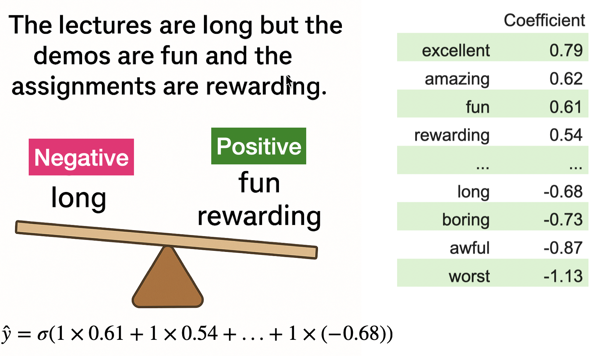
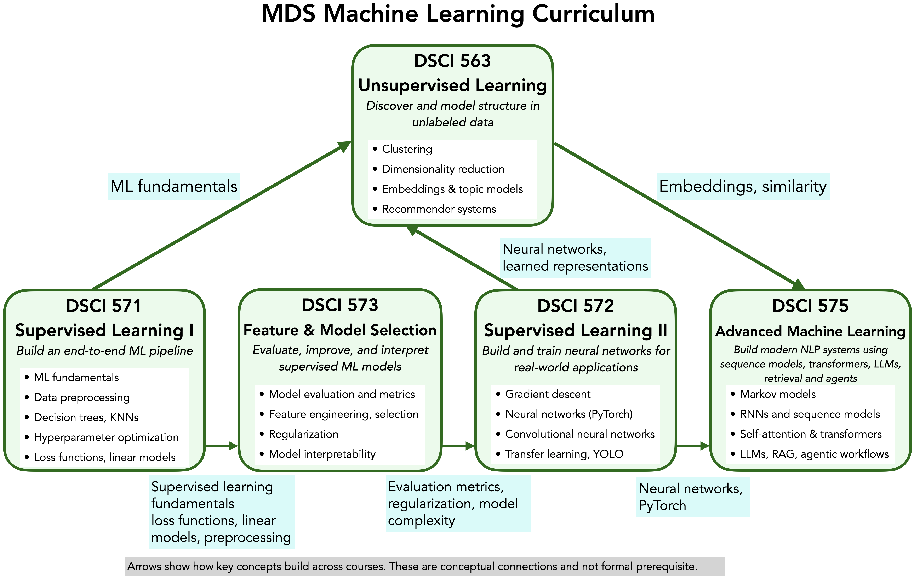

```{python}
#| include: false
from pathlib import Path
import matplotlib.pyplot as plt
import numpy as np
import pandas as pd
from IPython.display import display
from sklearn.compose import make_column_transformer
from sklearn.dummy import DummyClassifier
from sklearn.feature_extraction.text import CountVectorizer
from sklearn.impute import SimpleImputer
from sklearn.linear_model import LogisticRegression, Ridge
from sklearn.model_selection import cross_validate, train_test_split
from sklearn.pipeline import make_pipeline
from sklearn.preprocessing import OneHotEncoder, StandardScaler
from scipy.special import softmax
DATA_DIR = Path("data")
plt.rcParams.update({"font.size": 13, "figure.figsize": (9, 4)})
```

## Focus on the breath!

{.nostretch fig-align="center" width="500px"}

::: {.notes}
Take a moment to settle in. Put your feet on the floor, relax your shoulders, and take a slow breath in and out.
:::

## Announcements

::: {.notes}
Add current announcements before teaching.
:::

## iClicker: Lecture 7 recap {.slide-your-turn .smaller}

Let $z=\mathbf w^{\mathsf T}\mathbf x+b$ and $p=\sigma(z)=1/(1+e^{-z})=P(y=1\mid\mathbf x)$.

**Which statements are true? Select all that apply.**

- **A.** If $z=0$, then $p=0.5$; increasing $z$ increases $p$.
- **B.** The sigmoid converts the score directly into a class label.
- **C.** For a true label $y=1$, increasing $p$ from $0.6$ to $0.9$ reduces log loss.
- **D.** A correct class prediction always has zero log loss.
- **E.** Mean squared error gives larger errors disproportionately more weight than smaller errors.

::: {.notes}
Answers: A, C, and E. Allow about two minutes, then discuss each statement. A: sigmoid(0)=0.5 and sigmoid is increasing. B: sigmoid gives a probability; a separate threshold turns it into a class label. C: when y=1, loss is -log(p), so it falls from about 0.511 to 0.105. D: a correct prediction can still have positive log loss; for example, p=0.9 gives about 0.105 when y=1. E: MSE squares each residual before averaging, so doubling the size of an error quadruples its contribution. For example, residuals of 4 and 2 contribute squared errors of 16 and 4. This is why large errors have disproportionately more influence on MSE. Connect A to the raw scores used in today's hinge-versus-logistic comparison, C and D to how log loss rewards true-class probability, and E to today's comparison of MSE and MAE.
:::

## Today’s roadmap {.slide-goals .smaller}

1. **More loss functions:** regression, classification, fitting versus evaluation
2. **Model interpretation:** coefficients and feature contributions
3. **Multiclass classification:** class scores, softmax, and cross-entropy
4. **Conclusions:** overall workflow, ML course map, and what comes next

::: {.notes}
Suggested 80-minute pacing: opening 3, regression losses 8, classification losses 10, fitting versus evaluation 8, course evaluations 10, interpretation demo 12, multiclass and cross-entropy 19, conclusions 10. Answers to activities are in speaker notes. Chapter 8 is the content source throughout.
:::

# More loss functions

How does the choice of loss change what fitting rewards?

# Regression losses

How strongly should a large error count?

## Your turn: Delivery-time predictions {.slide-your-turn .smaller}

Residual $r_i=y_i-\hat y_i$, in minutes.

| Model | Residuals on four validation deliveries |
|---|---|
| A | 0, 0, 0, 8 |
| B | 3, 3, 3, 3 |

$$\operatorname{MAE}=\frac1n\sum_i|r_i|,
\qquad \operatorname{MSE}=\frac1n\sum_i r_i^2$$

1. Calculate MAE and MSE for both models.
2. Which model does each metric favour?

::: {.notes}
Allow two minutes, then reveal the next slide. Ask students to think about whether one substantial delivery error matters more than several small ones before calculating.
:::

## MAE and MSE can rank models differently {.smaller}

| Model | MAE (minutes) | MSE (minutes squared) |
|---|---:|---:|
| A: 0, 0, 0, 8 | **2** | 16 |
| B: 3, 3, 3, 3 | 3 | **9** |

- **MAE favours A:** every additional minute counts equally.
- **MSE favours B:** the 8-minute error contributes $8^2=64$.
- Doubling a residual doubles absolute loss and quadruples squared loss.

::: {.notes}
MAE A=(0+0+0+8)/4=2, B=12/4=3. MSE A=64/4=16, B=36/4=9. Do not compare the numerical size of MAE with MSE, because units differ. Both losses are symmetric: an error of minus eight has the same penalty as plus eight. Neither captures different costs for early versus late predictions.
:::

## Absolute and squared loss {.model-plot .smaller}

```{python}
r = np.linspace(-4, 4, 400)
fig, ax = plt.subplots()
ax.plot(r, r**2, label="Squared loss", color="#419599", linewidth=3)
ax.plot(r, np.abs(r), label="Absolute loss", color="#b66837", linewidth=3)
ax.set(xlabel="Residual: observed − predicted", ylabel="Loss (units differ)")
ax.legend()
fig.tight_layout()
plt.show()
```

Squared loss gives large errors relatively more influence.

::: {.notes}
These are per-example loss curves, whose averages give MSE and MAE. Focus on growth rates rather than comparing curve heights across units. Squared loss is more sensitive to unusual target values. Absolute loss still gives unusual observations influence.
:::

## Choosing MAE or MSE {.smaller}

| | MAE | MSE |
|---|---|---|
| Penalty | Grows linearly with error size | Grows quadratically with error size |
| Use when… | Each extra unit of error costs the same | Large errors are disproportionately costly |
| Extreme errors | Less sensitive | Can dominate the loss |
| Units | Same as the target | Squared target units |
| Optimization | Corner at zero | Smooth and differentiable |

**Choose based on the cost of errors in your application.**

::: {.notes}
Connect to the delivery-time example: does one eight-minute error matter more than several three-minute errors? MAE is more robust to extreme target values, but neither loss protects against every kind of outlier, including unusual input values. An extreme error may reflect noise, a recording error, or an important rare case; investigate rather than automatically choosing to penalize it more. Both losses are continuous. Absolute loss has a corner at zero, but suitable optimization methods can still minimize MAE; squared loss is differentiable and convenient for gradient-based methods. Optimization convenience is a fitting consideration, while application costs should guide evaluation. RMSE takes the square root of MSE, restoring target units while preserving model rankings on the same evaluation data.
:::

# Classification losses

The same score form can lead to different fitted coefficients

## Logistic loss in terms of the score {.smaller}

Fix a review whose **true sentiment is positive** ($y=1$).

$$z=\mathbf w^{\mathsf T}\mathbf x+b,
\qquad p=P(y=1\mid\mathbf x)=\sigma(z)=\frac{1}{1+e^{-z}}$$

Substitute the sigmoid into the familiar log loss:

$$L=-\log(p)=-\log\left(\frac{1}{1+e^{-z}}\right)
=\log(1+e^{-z})$$

Increasing $z$ increases the true-class probability and reduces loss.

::: {.notes}
Recall lecture 7: the linear score becomes a probability through the sigmoid. Since this review is truly positive, binary log loss selects -log(p). Taking the negative log of a reciprocal gives log(1+exp(-z)). We can now compare losses on the same raw-score axis. Throughout this comparison, keep the true class fixed as positive; for a negative example, reflect the loss curves horizontally.
:::

## Linear SVM and hinge loss {.smaller}

Both models compute $z=\mathbf w^{\mathsf T}\mathbf x+b$.

- **Same class decision rule:** positive scores favour class 1; negative scores favour class 0.
- **Different fitting losses:** they can learn different coefficients and biases.

For this **positive review** ($y=1$):

$$L_{\text{logistic}}=\log(1+e^{-z}),
\qquad L_{\text{hinge}}=\max(0,1-z)$$

Hinge loss remains positive for $0<z<1$, even though the class prediction is correct.

::: {.notes}
Connect to the SVM from lecture 3: here we use a linear kernel so that the score has the same form as logistic regression. With the usual 0.5 probability threshold, logistic regression and a linear SVM both use the sign of their own score to choose a class; tie handling at zero can depend on the implementation. The fitted scores and boundaries need not match. Logistic regression converts its score to a probability; an SVM score is not automatically a probability. Regularization also affects fitting. Some implementations, including the default LinearSVC, use squared hinge rather than ordinary hinge loss. Next, explore how the two losses respond to the same score in the interactive demo.
:::

## Hinge loss vs. logistic loss

```{=html}
<iframe
  src="img/hinge_vs_logistic.html"
  width="100%"
  height="570"
  style="border: none;"
  title="Hinge vs logistic loss">
</iframe>
```

## Hinge loss and support vectors

- Hinge loss focuses fitting on examples that are **misclassified or close to the decision boundary**, connecting to the support vectors we saw earlier.
- For this **positive review**, once $z \geq 1$, the loss is zero: pushing its score higher brings no further benefit.

::: {.notes}
Recall that support vectors determine the SVM decision boundary. Examples inside the margin or misclassified have positive hinge loss. Examples exactly at z=1 can also be support vectors even though their hinge loss is zero. With regularization, examples beyond this threshold do not directly determine the fitted boundary. The threshold here applies to the positive review; for a negative review, hinge loss is zero when z is at most -1. No formal introduction to margins is needed here.
:::

## Exponential loss {.smaller}

For the same **positive review** ($y=1$), another alternative is:

$$L_{\text{exponential}}=e^{-z}$$

- Negative scores are wrong for this review; their penalty grows exponentially as $z$ decreases.
- Positive scores reduce the loss toward zero, without reaching zero at any finite score.
- Exponential loss connects to **AdaBoost**, coming in DSCI 573.

::: {.notes}
Present exponential loss as another way to reward increasing the true-class score. Strongly wrong scores receive particularly large penalties, so mislabeled or difficult examples can have substantial influence. AdaBoost uses an additive score and exponential loss; it is not simply logistic regression with a different setting. Keep the boosting algorithm out of scope and use the next plot to compare all three shapes.
:::

## Comparing classification losses {.model-plot .smaller}

```{python}
z = np.linspace(-2, 4, 400)
fig, ax = plt.subplots()
ax.plot(z, np.logaddexp(0, -z), label="Logistic", linewidth=3, color="#419599")
ax.plot(z, np.maximum(0, 1-z), "--", label="Hinge", linewidth=3, color="#b66837")
ax.plot(z, np.exp(-z), ":", label="Exponential", linewidth=3, color="#6b5792")
ax.axvline(0, color="gray", linewidth=1)
ax.axvline(1, color="gray", linewidth=1, linestyle=":")
ax.set(xlabel="Score z (true class is positive)", ylabel="Per-example loss")
ax.legend()
fig.tight_layout()
plt.show()
```

Hinge loss reaches zero at $z=1$. Exponential loss penalizes strongly wrong scores most sharply.

::: {.notes}
The vertical lines mark the decision boundary and the hinge margin. At a positive score below one the prediction is correct but hinge loss remains positive. Log and exponential losses approach zero without reaching it at finite scores. Numerical values across these losses are not a common performance scale.
:::

## Classification losses: Behaviour and uses {.smaller}

| | Logistic | Hinge | Exponential |
|---|---|---|---|
| Emphasis | True-class probability | Correct class with sufficient separation | Strong penalty for confidently wrong scores |
| Zero loss ($y=1$) | Approaches zero | Zero at $z\geq1$ | Approaches zero |
| Typical use | Logistic regression; probabilities | SVMs; class decisions | AdaBoost and related boosting methods |
| Limitation | Confident mistakes incur large loss | Raw scores are not probabilities | Strong sensitivity to very wrong scores |

**Loss choice usually comes through choosing a model or algorithm.**

::: {.notes}
Use this as practical orientation, not a claim that one loss is universally best. Logistic regression is a natural starting point when probability predictions are needed, though probabilities still need validation. SVMs focus on separation and are useful candidates when class decisions are the goal; probability estimates require an additional method. Exponential loss is mainly encountered through algorithms such as AdaBoost, rather than selected as a standalone replacement in LogisticRegression. All three can be affected by mislabeled examples; exponential loss grows fastest for strongly negative scores in this comparison. Logistic and exponential losses approach zero as z increases without reaching it for finite scores. Hinge loss reaches zero at one for the positive example. Compare candidate models on validation data using measures appropriate to the application, rather than comparing the numerical values of different fitting losses.
:::

## iClicker: Correct prediction, positive loss? {.slide-your-turn .smaller}

A truly positive review receives score $z=0.5$.

Which statements are true? Select all that apply.

- **A.** Its predicted class is positive.
- **B.** Its hinge loss is zero.
- **C.** Its hinge loss is 0.5.
- **D.** Its logistic loss is positive.

::: {.notes}
Answers A, C, D. Hinge is max(0,1-0.5)=0.5. Logistic is log(1+exp(-0.5)), about 0.474. Prediction correctness alone does not establish that the model has achieved a large margin or low probability loss. For a negative true review, a positive score would be wrong.
:::

# Accuracy versus loss

Fitting a model and evaluating its predictions

## Accuracy can stay fixed while log loss improves {.smaller}

For a **truly positive review**, compare two predictions:

| $P$(positive) | Predicted class | Correct? | Log loss |
|---:|---|---|---:|
| 0.20 | Negative | No | 1.609 |
| 0.30 | Negative | No | 1.204 |

- Both predictions have the same accuracy on this review.
- Increasing the true-class probability reduces log loss.
- Smooth changes in log loss guide logistic-regression fitting.

::: {.notes}
This binary example builds on chapter 7 without requiring multiclass probabilities. Use the usual 0.5 threshold. Losses are -log(0.2) and -log(0.3). Accuracy has flat regions and jumps as coefficients change. We return to this distinction for penguin species later.
:::

## Fitting objective and evaluation measure {.smaller}

| Stage | Data | Purpose |
|---|---|---|
| Fit each candidate | Training portion of each fold | Learn coefficients using the estimator’s loss and regularization |
| Compare candidates | Validation portion of each fold | Rank candidates using the chosen scorer |
| Final evaluation | Reserved test set | Assess the selected workflow |

**A loss can also be an evaluation measure:** log loss can assess validation probabilities.

::: {.notes}
Accuracy has flat regions and jumps as coefficients change. Log loss responds smoothly to changes in true-class probability, even when the predicted class stays fixed. Logistic regression therefore fits with log loss even when we choose hyperparameters by accuracy. Specify the development scorer before final test evaluation.
:::

## Your turn: What changed inside the search? {.slide-your-turn .smaller}

| `C` | Mean validation accuracy | Mean validation log loss |
|---:|---:|---:|
| 0.1 | 0.96 | 0.12 |
| 10 | 0.97 | 0.18 |

1. Which `C` wins with `scoring="accuracy"`?
2. Which wins with `scoring="neg_log_loss"`?
3. Does the scorer change how each candidate learns its coefficients?

::: {.notes}
Illustrative binary sentiment results from chapter exercise 8.1. Accuracy selects C=10. Negative log loss selects C=0.1 because -0.12 is greater than -0.18. Each candidate still fits logistic loss plus its regularization penalty. If the application needs probabilities, the log-loss result supports C=0.1 despite slightly lower accuracy. The scorer can change candidate ranking and selected C.
:::

## Course evaluations (~10 minutes)

- The online course evaluations are up, it'll be great if you can fill them in when you get a chance. 


# Model interpretation

How do coefficients and feature values combine in a prediction?

## Sentiment analysis example {.smaller}
:::: {.columns}

:::{.column width="55%"}

:::

:::{.column width="45%"}
- Logistic regression learns **coefficients for each word** from training data.  
- Positive coefficients $\rightarrow$ push prediction toward positive class.  
- Negative coefficients $\rightarrow$ push prediction toward negative class.  
- In this example, positive words (_fun_, _rewarding_) outweigh the negative word (_long_), so the overall sentiment is likely **positive**.  
:::

::::

## Interpretation of coefficients

[Class demo]()

::: {.notes}
Continue the binary sentiment example from the loss comparison: inspect coefficients, then reconstruct an individual score using count times coefficient plus intercept. Use the chapter's sentiment and housing demonstrations. Check class order, feature units after preprocessing, and what other features are held fixed. Coefficients explain the fitted calculation rather than causal effects. Next, extend the binary score-and-probability calculation to several classes.
:::

# Multiclass classification

One example, one label, several possible classes

## Penguin species {.smaller}

{.nostretch width="720px" fig-alt="Chinstrap, Gentoo, and Adelie penguins"}

- **Inputs:** bill length, bill depth, flipper length, body mass
- **Target:** Adelie, Chinstrap, or Gentoo
- Multilabel tasks allow several labels for one example, such as “penguin” and “snow”.

::: {.notes}
Artwork by @allison_horst, Palmer Penguins project. Source: https://allisonhorst.github.io/palmerpenguins/articles/art.html. Data: https://allisonhorst.github.io/palmerpenguins/. The local CC0 data have 344 penguins. Labels identify species, with no numeric order or distance. This is a multiclass task because each example has exactly one target species.
:::

## One linear score per class {.smaller}

$$z_k=\mathbf w_k^{\mathsf T}\mathbf x+b_k$$

- Each class $k$ has its own coefficients and intercept.
- $\mathbf x$ contains the **preprocessed** measurements.
- Scores can be any real numbers. They do not yet form probabilities.

For one illustrative penguin:

| Adelie | Chinstrap | Gentoo |
|---:|---:|---:|
| $z_1=2$ | $z_2=1$ | $z_3=0$ |

::: {.notes}
Connect to the single score in binary logistic regression. These scores are invented for a hand calculation, not fitted outputs. Ask why applying sigmoid independently would fail: the resulting values need not sum to one. Pairwise decision boundaries of multinomial logistic regression remain linear in the represented features.
:::

## Softmax: Scores to probabilities {.smaller}

$$p_k=\frac{e^{z_k}}{\sum_{j=1}^{K}e^{z_j}}$$

| Species | Score | Exponentiate | Normalize |
|---|---:|---:|---:|
| Adelie | 2 | 7.389 | **0.665** |
| Chinstrap | 1 | 2.718 | 0.245 |
| Gentoo | 0 | 1.000 | 0.090 |
| Total | | 11.107 | 1.000 |

All probabilities are positive and sum to 1.

::: {.notes}
Walk through one numerator and the common denominator. Increasing one score while holding the others fixed raises its probability and lowers the others. Softmax defines a probability calculation, but does not guarantee that the probabilities will be reliable on new data.
:::

## Your turn: Softmax predictions {.slide-your-turn .smaller}

Class order: **Adelie, Chinstrap, Gentoo**.

1. A model returns $(0.40, 0.35, 0.25)$. Which class does it predict?
2. Must the winning probability exceed 0.5?
3. What probabilities result if all three scores are equal?
4. Would adding 100 to every score change the probabilities?

::: {.notes}
Give pairs two minutes. Answers: Adelie, no, one third each, and no. A common shift cancels between numerator and denominator. This invariance permits subtracting the largest score before exponentiating, avoiding overflow. It is relative scores that matter.
:::

## Softmax in Python {.smaller}

```python
scores = np.array([2.0, 1.0, 0.0])
weights = np.exp(scores - scores.max())
probabilities = weights / weights.sum()
# Or use scipy.special.softmax(scores)
```

```{python}
pd.DataFrame({"Score": [2., 1., 0.], "Probability": softmax([2., 1., 0.])},
             index=["Adelie", "Chinstrap", "Gentoo"]).round(3)
```

Subtracting the same value from every score leaves softmax unchanged.

# Cross-entropy loss

How much probability did the model assign to the true class?

## One-hot targets and cross-entropy {.smaller}

True species: **Chinstrap**. Class order: Adelie, Chinstrap, Gentoo.

$$\mathbf y=\begin{bmatrix}0 \\ 1 \\0\end{bmatrix},
\qquad \hat{\mathbf p}=\begin{bmatrix}0.1\\0.8\\0.1\end{bmatrix}$$

$$L=-\sum_{k=1}^{K} y_k\log(\hat p_k)
=-\log(\hat p_{\text{true class}})$$

$$L=-[0\log(0.1)+1\log(0.8)+0\log(0.1)]\approx0.223$$

::: {.notes}
Use natural logarithms throughout. One-hot target notation selects the true-class term. It is distinct from one-hot encoding input features. Scikit-learn LogisticRegression accepts ordinary species labels, so students do not need to construct target vectors. If the true-class probability were 0.05, the loss would be about 2.996.
:::

## Binary and multiclass log loss {.smaller}

For two classes, the target indicators are $y$ and $1-y$:

$$L=-[y\log(\hat p)+(1-y)\log(1-\hat p)]$$

For $n$ examples and $K$ classes, average the losses:

$$\overline L=-\frac1n\sum_{i=1}^n\sum_{k=1}^K
 y_{ik}\log(\hat p_{ik})$$

- High probability for the true class gives low loss.
- A confident wrong prediction can receive a very large loss.

::: {.notes}
Binary cross-entropy is the two-class case of multiclass cross-entropy. The same true-class probability principle applies. Distinguish per-example loss from a dataset mean.
:::

## iClicker: Is a log loss of 1.10 good? {.slide-your-turn .smaller}

A three-class model has mean **validation log loss 1.10**.

A baseline assigns probability $1/3$ to each class for every example.

Which statement is best supported?

- **A.** The model is useful because 1.10 is close to zero.
- **B.** The model performs about the same as this baseline.
- **C.** The model has about 110% classification error.
- **D.** We cannot compute the baseline loss without its accuracy.

::: {.notes}
Answer B. The baseline loss is -log(1/3) = log(3), about 1.099. A loss needs a reference point. A difference this small could reflect sample variation. For imbalanced classes, also compare with a model predicting training class proportions, evaluated on the same validation data. Uniform probability predictions differ from randomly guessing a single class label.
:::

## Penguins: A complete prediction pipeline {.smaller}

```python
penguin_pipeline = make_pipeline(
    SimpleImputer(strategy="median"),
    StandardScaler(),
    LogisticRegression(solver="lbfgs", max_iter=1000),
)
```

- Reserve a test set first.
- Compare with `DummyClassifier()` using training-data CV.
- Keep imputation and scaling inside the pipeline.
- Inspect both accuracy and log loss. Leave test data untouched.

::: {.notes}
Use the chapter's split: test_size=0.25, random_state=571, stratify=species. Four numeric features only. Each fold learns imputation medians and scaling from its training portion. This fixed pipeline traces predictions rather than repeating hyperparameter search.
:::

## Penguins: Validation results {.smaller}

```{python}
#| include: false
penguins = pd.read_csv(DATA_DIR / "penguins.csv")
penguin_features = ["bill_length_mm", "bill_depth_mm", "flipper_length_mm", "body_mass_g"]

X_penguins = penguins[penguin_features]
y_penguins = penguins["species"]
X_penguins_train, X_penguins_test, y_penguins_train, y_penguins_test = train_test_split(
    X_penguins, y_penguins, test_size=0.25, random_state=571, stratify=y_penguins
)
penguin_pipeline = make_pipeline(
    SimpleImputer(strategy="median"), StandardScaler(),
    LogisticRegression(solver="lbfgs", max_iter=1000),
)
penguin_results = []
for name, model in {
    "Class-proportion baseline": DummyClassifier(strategy="prior"),
    "Logistic regression": penguin_pipeline,
}.items():
    scores = cross_validate(
        model, X_penguins_train, y_penguins_train, cv=5,
        scoring={"accuracy": "accuracy", "log_loss": "neg_log_loss"},
    )
    penguin_results.append({
        "Model": name,
        "Mean CV accuracy": scores["test_accuracy"].mean(),
        # Reverse the negative-loss scorer so smaller reported losses are better.
        "Mean CV log loss": -scores["test_log_loss"].mean(),
    })

```

```{python}
pd.DataFrame(penguin_results).set_index("Model").round(3)
```

- Accuracy evaluates **class decisions**.
- Log loss evaluates **probability predictions**.
- Both improve relative to the class-proportion baseline here.

::: {.notes}
Five-fold CV on the training split. Negate sklearn's neg_log_loss output to report ordinary positive loss, where lower is better. These are validation estimates, not test results. The test set remains untouched.
:::

## Same class prediction, different probabilities {.slide-your-turn .smaller}

| Model | $P$(Adelie) | $P$(Chinstrap) | $P$(Gentoo) |
|---|---:|---:|---:|
| A | 0.40 | 0.35 | 0.25 |
| B | 0.90 | 0.05 | 0.05 |

1. What class does each model predict?
2. Which has lower log loss if the true class is Adelie?
3. Which has lower log loss if it is Chinstrap?
4. Can accuracy distinguish the models on this example?

::: {.notes}
Both predict Adelie. If Adelie is true, B has lower loss: 0.105 versus 0.916. If Chinstrap is true, A has lower loss: 1.050 versus 2.996. Accuracy counts both correct in the first case and both incorrect in the second. More extreme probabilities help only when they favour the observed outcome.
:::

# Course conclusions

The pieces form one supervised-learning workflow

## Overall workflow: Development {.slide-summary .smaller}

1. **Define the task:** target, examples, available inputs, intended use.
2. **Reserve test data:** choose a split that matches the prediction setting.
3. **Explore training data:** missingness, unusual values, possible leakage.
4. **Build pipelines:** numerical, categorical, and text preprocessing.
5. **Compare with a baseline:** consistent CV splits and suitable measures.
6. **Tune promising models:** select using training-data validation results.

::: {.notes}
Remind students that data available after the outcome can leak the target, even if it sits in an ordinary-looking feature column. Learned preprocessing stays inside folds. Split by time or group when the prediction setting requires it. Model selection includes representation choices as well as hyperparameters.
:::

## Overall workflow: Interpretation and evaluation {.slide-summary .smaller}

7. **Inspect the model and its mistakes.** Check feature contributions and limitations.
8. **Evaluate the selected workflow on test data.** Settle development choices first.
9. **Communicate the evidence.** Report the baseline, evaluation procedure, and limitations.

If inspection suggests changes, return to training-data development.

::: {.notes}
Interpretation is part of the analysis workflow, not another transformer in sklearn Pipeline. If final test performance disappoints, report it rather than repeatedly tuning against that same test set. Error inspection on validation data can guide development while preserving final assessment.
:::

## Your turn: Review this workflow {.slide-your-turn .smaller}

A team routes support requests to three departments. It:

- Includes the department that eventually resolved each request as an input.
- Learns the text vocabulary from all requests before splitting.
- Tries many values of `C` and selects the best test accuracy.
- Claims that accuracy shows its probabilities are reliable.

What would you change?

::: {.notes}
Allow pairs two minutes. Remove the resolving department, which is unavailable at prediction time and reveals the outcome. Reserve test data before learning a vocabulary. Put CountVectorizer and the classifier in a pipeline inside CV. Tune C on training-data CV and compare with a baseline. Choose metrics for the intended use: accuracy alone does not assess probability quality. Final test evaluation follows settled development choices. Ask groups to identify one error each.
:::

## What you can do now {.slide-summary .smaller}

- Build a complete pipeline for numerical, categorical, and text inputs.
- Compare model families against a baseline without test leakage.
- Use validation to choose hyperparameters and representations.
- Explain how scores, probabilities, losses, and predictions relate.
- Inspect a fitted model and communicate what its evidence supports.

::: {.notes}
Invite students to recall the first decision tree from lecture 1 and connect it with the workflow they can now carry out. Today's new loss functions complement that workflow rather than replacing it.
:::

## ML course map

{.nostretch width="920px" height="500px" fig-alt="MDS machine-learning course map connecting supervised learning, optimization, unsupervised learning, and advanced topics"}

::: {.notes}
Map reused from the course materials and chapter 8. DSCI 571 provides supervised-learning fundamentals. DSCI 573 deepens evaluation, selection, regularization, and interpretation. DSCI 572 develops optimization and neural networks. DSCI 563 explores unlabelled data. DSCI 575 extends representations and neural networks. Connections are conceptual, not a statement of formal prerequisites.
:::

## What’s coming in DSCI 573 {.smaller}

| Question | Topic |
|---|---|
| Do different mistakes have different costs? | Evaluation metrics |
| Can combining models improve predictions? | Ensembles |
| How can we control model flexibility? | Regularization |
| How can we explain more complex models? | Transparency and SHAP |
| How can we represent inputs more usefully? | Feature engineering |
| Which inputs should we retain? | Feature selection |

::: {.notes}
Frame these as extensions of tools students already know. Feature engineering develops representations, while feature selection chooses which inputs to retain. Both belong in development and validation, like preprocessing and hyperparameter search. Course connections follow the supplied chapter.
:::


## Thank you!! {.slide-summary}

I hope you learned something useful from the course. You all are wonderful students and I had fun teaching this course ♥️! 

{.nostretch fig-align="center" width="300px"}


FYI: If you didn't fill out course evaluations during class , it'll be great if you can fill them in when you get a chance. 

::: {.notes}
Pause for final questions and thank the class.
:::
